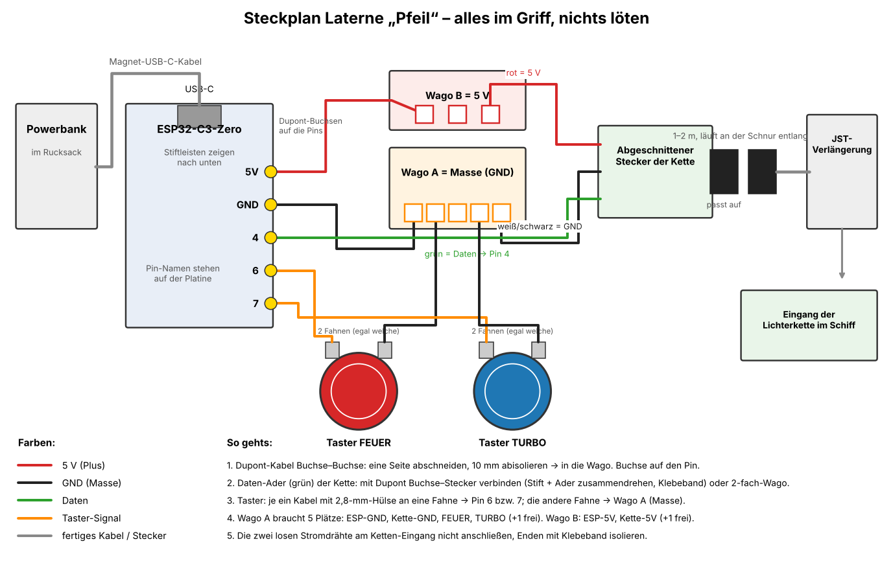

# Raumjäger „Pfeil“ – Laterne für Toni

Ein eigener Sci-Fi-Jäger, der waagerecht am Bambusstab hängt, als würde er vorbeifliegen.

- **Licht:** Eine adressierbare LED-Lichterkette läuft durch das ganze Schiff. Die Flammen flackern wie Feuer, die Kanzel leuchtet blau, Fenster, Heckgitter und der Schriftzug **TONI** glühen warm. Vorn leuchten zwei Scheinwerfer.
- **Bedienung:** Am Griff am Stab sitzen zwei große Knöpfe.
  - **FEUER:** Die Laserkanonen schießen abwechselnd links und rechts. Gedrückt halten heißt Dauerfeuer.
  - **TURBO:** Die Triebwerke lodern 4 Sekunden hell und blau auf.
- **Strom:** Eine Powerbank im Rucksack, verbunden mit einem magnetischen USB-C-Kabel zum Griff. Zieht jemand am Kabel, löst sich der Magnet.
- **Löten:** Nichts löten. Alles wird gesteckt, abisoliert und in Wago-Klemmen gesteckt. Nur an die Taster crimpst du 4 Flachsteckhülsen.

Maße: Länge mit Flammen etwa 350 mm, Spannweite 300 mm, Höhe 80 mm. Druckgewicht des Schiffs etwa 230 g.
Bilder: `bilder/` (0 Überblick, 1 Tag, 2 Nacht, 3 Nacht von hinten, 4 Einzelteile, 5 von oben, 6 Seite, 7 Griff, 8 Flügel mit offenem Kabelkanal, 9 Flügel mit Deckeln)

## Druckteile

Alle Teile drucken **ohne Stützen**. Jedes Teil wurde Schicht für Schicht geprüft: Es gibt keine freien Inseln und keine Überhänge über 1,2 mm, nur kurze Brücken.

| Datei | Anz. | Farbe (Vorschlag) | Größe (mm) | Lage auf dem Bett |
| --- | --- | --- | --- | --- |
| `druck-rumpf-unten.stl` | 1 | Hellgrau | 209 × 209 × 58 (diagonal) | Boden unten |
| `druck-rumpf-oben.stl` | 1 | Hellgrau | 170 × 92 × 41 | Deck unten |
| `druck-kanzel.stl` | 1 | Anthrazit | 78 × 46 × 25 | Kragen unten |
| `druck-leitwerk.stl` | 1 | Orange | 56 × 54 × 3 | flach |
| `druck-fluegel-links.stl` / `-rechts` | je 1 | Anthrazit | 110 × 113 × 14 | flach, Kabelkanal oben |
| `druck-kanaldeckel-links.stl` / `-rechts` | je 1 | Anthrazit | 63 × 95 × 1,2 | flach |
| `druck-fussdeckel-links.stl` / `-rechts` | je 1 | Anthrazit | 26 × 10 × 1,2 | flach |
| `druck-triebwerk.stl` | **2** | Hellgrau | 36 × 36 × 118 | Düse unten |
| `druck-flamme.stl` | **2** | **Grau transparent** | 40 × 43 × 84 | Kragen unten, Brim |
| `druck-flammenhalter.stl` | **2** | Grau transparent oder Hellgrau | 25 × 25 × 31 | Gitterplatte unten |
| `druck-kanone.stl` | **2** | **Grau transparent** | 14 × 16 × 76 | Mündung oben, Brim |
| `druck-griff.stl` | 1 | Anthrazit | 101 × 39 × 37 | Oberseite unten |
| `druck-griff-boden.stl` | 1 | Anthrazit | 96 × 34 × 13 | Platte unten, Sättel oben |
| `druck-griff-bock.stl` | 1 | Anthrazit | 18 × 9 × 15 | stehend |

Alle STLs sind schon richtig gedreht und passen auf das 260er-Bett. Der Rumpf liegt diagonal. Links und rechts sind bei Flügeln und Deckeln Spiegelbilder, also beide Dateien drucken.

**Einstellungen:** PLA, 0,4er Düse, 0,2 mm Schicht, **3 Wände** (die Wände sind 1,2 mm, dann druckt der Slicer sie massiv).

- **Flammen und Kanonen:** 4 Wände und 15 % Füllung, die Flammenwand ist 1,6 mm dick. Brim 5 mm, sonst kippen die schmalen Teile.
- **Stützen:** keine, bei keinem Teil. Brücken bis 30 mm kommen vor (Taster-Löcher im Griff, Mittelstrebe der Kanzel, Laschenschlitze) und sind normal.
- Beim Slicen angezeigte blaue Stellen sind Rillen, Kabeltunnel und Lochdecken mit höchstens 1,2 mm Überstand. Die druckt der K2 so.

## Teile (bestellt am 4.11.)

| Teil | Menge | Wofür |
| --- | --- | --- |
| **Waveshare ESP32-C3-Zero** (Dev Board-M, mit Stiftleisten) | 1 | Steuerung im Griff |
| **BTF-LIGHTING WS2812B-Lichterkette**, 5 m, 50 LEDs, 10 cm Abstand | 1 | Licht im Schiff |
| **GTIWUNG JST-SM-3-Pin-Verlängerung**, 1 m, Stecker auf Buchse | 1–2 (4er-Set) | vom Griff zum Schiff, für 2 m steckst du zwei zusammen |
| **ELEGOO Dupont-Kabel-Set** (M-M, F-M, F-F) | 1 | Verbindungen im Griff |
| **EG STARTS Arcade-Taster 24 mm** | 2 (Rot = FEUER, Blau = TURBO) | Knöpfe am Griff |
| Flachsteckhülsen 2,8 mm (zum Crimpen, hast du) | 4 | Kabel an die Taster |
| **AUFU Magnet-Ladekabel USB-C**, 2 m | 1 | Powerbank → Griff |
| Wago-Klemmen (hast du) | 1× 5-fach + 1× 2- oder 3-fach | Masse und 5 V verteilen |
| Powerbank mit **USB-C-Ausgang** (hast du) | 1 | Die LEDs brauchen im Schnitt 0,3–0,5 A, höchstens 1 A (im Code begrenzt). |
| Schrauben 3 × 10 mm (Blech-/Kunststoffschraube) | 4 | Boden des Griffs |
| Kabelbinder | 2 | Griff an den Stab |
| Transparentpapier Orange/Gelb und Hellblau, Klebestift | | Fenster |
| Heißkleber | | Flügel, Triebwerke, Kanonen, Leitwerk, Kanzel |
| Schnur 2–3 mm | | Aufhängung |

Statt einer 5-fach-Wago gehen auch zwei 3-fach-Wagos, die du mit einem kurzen Drahtstück verbindest. Die Masse-Klemme braucht 4 Plätze.

## Vorbereiten

1. **Eingang der Lichterkette finden.** Die Kette hat an beiden Enden einen schwarzen 3-poligen Stecker. Der Eingang ist meist mit Pfeil, „IN“ oder „DIN“ beschriftet, oft hängen dort zusätzlich zwei lose Stromdrähte. Die losen Drähte brauchst du nicht: Enden mit Klebeband isolieren.
2. **Ausgangsstecker abschneiden.** Den Stecker am anderen Ende (Ausgang) mit etwa 5 cm Kabel abschneiden. Er wird dein Anschluss im Griff, denn er passt genau auf das Ende des Verlängerungskabels. Die 3 Adern 10 mm abisolieren.
3. **Adern bestimmen.** Schau am Eingang der Kette, welche Farbe welche Ader ist (aufgedruckt oder auf dem Etikett). Meist: Rot = 5 V, Weiß oder Schwarz = GND, Grün = Daten. Die Farben am abgeschnittenen Stecker sind dieselben. Im Zweifel schick mir ein Foto.
4. **Taster-Kabel crimpen.** 4 Dupont-Kabel Buchse–Buchse nehmen, jeweils ein Ende abschneiden, abisolieren und eine 2,8-mm-Hülse ancrimpen.
   - Taster FEUER: ein Kabel mit Dupont-Buchse auf GPIO6, das andere kommt abisoliert in die Masse-Wago.
   - Taster TURBO: genauso mit GPIO7.
   - Bei diesen Tastern ist es egal, welche der zwei Fahnen du nimmst.

## Steckplan (Griff)



Das Bild liegt als `elektronik/steckplan.png` bei. Darunter dasselbe als Text:

```
Powerbank (Rucksack) ── Magnet-USB-C ──► ESP32-C3-Zero (USB-C zeigt zum Loch in der Stirnwand)

ESP32-C3-Zero                 Wago A (Masse, 5-fach)    Wago B (5 V)
  5V    ── Dupont ───────────────────────────────────► [B]
  GND   ── Dupont ─────────────► [A]
  GPIO4 ── Dupont ──────────────────────────────────────────► Daten-Ader  ┐
                                 [A] ───────────────────────► GND-Ader    ├ abgeschnittener Stecker der Kette
                                                       [B] ──► 5V-Ader     ┘
  GPIO6 ── Dupont ── Taster FEUER ── [A]
  GPIO7 ── Dupont ── Taster TURBO ── [A]

abgeschnittener Stecker ◄─► JST-Verlängerung (1–2 m, entlang der Schnur) ◄─► Eingang der Lichterkette im Schiff
```

- **Dupont an Wago:** Bei einem Dupont-Kabel ein Ende abschneiden, 10 mm abisolieren und in die Wago stecken.
- **Daten-Ader an GPIO4:** Ein Dupont-Kabel Buchse–Stecker nehmen. Die Buchse kommt auf GPIO4, den Stift drehst du mit der abisolierten Daten-Ader zusammen und sicherst ihn mit Klebeband oder Schrumpfschlauch. Alternativ beide Enden abisoliert in eine 2-fach-Wago stecken.
- Die Pins sind auf der Platine beschriftet (5V, GND, 4, 6, 7). Die Stiftleisten zeigen nach unten.
- **Optional:** Ein Elko (470–1000 µF, 6,3 V oder mehr) kann direkt in Wago A und B gesteckt werden. Das glättet Stromspitzen. Langes Bein = Plus = B.

Zuerst den **Bock** in die flache Tasche im Griffboden kleben (Heißkleber oder Sekundenkleber). Der ESP32 liegt im Griff auf diesem Bock, die Stiftleisten zeigen nach unten. Die Dupont-Stecker hängen links und rechts neben dem Bock. Schieb ihn so weit an die Stirnwand, dass der Magnetkopf bündig im Loch sitzt. Er ist 1 mm länger als der Bock, das ist egal. Dann mit doppelseitigem Klebeband fixieren.

Die Taster werden von oben in die Löcher gedrückt, bis sie einrasten. Innen ist die Decke um die Löcher auf 1,6 mm ausgedünnt, damit die Schnappnasen greifen. Sitzen sie zu locker, einen Tropfen Heißkleber von innen.

Der Boden sitzt **innerhalb** der Griffwände und schließt unten bündig ab. Von unten mit 4 Schrauben in die Dome schrauben, dann mit 2 Kabelbindern durch die Sättel an den Stab binden.

**Erster Test:** Powerbank → Magnetkabel → ESP. Leuchtet die kleine LED auf dem Board, liefert die Powerbank Strom über USB-C.

## Code aufspielen

1. Arduino IDE installieren. Unter *Einstellungen → Zusätzliche Boardverwalter-URLs* `https://espressif.github.io/arduino-esp32/package_esp32_index.json` eintragen. Im Boardverwalter **esp32** von Espressif installieren.
2. Im Bibliotheksverwalter **Adafruit NeoPixel** installieren.
3. `elektronik/pfeil_licht/pfeil_licht.ino` öffnen. Board **ESP32C3 Dev Module** wählen, **USB CDC On Boot: Enabled**. Per USB-C (normales Kabel, nicht das Magnetkabel) hochladen.
4. Erkennt der PC das Board nicht: **BOOT**-Taste auf dem Board gedrückt halten, USB einstecken, loslassen und nochmal hochladen. Danach einmal **RESET** drücken.

### Updates über WLAN (optional)

Oben im Sketch stehen `WLAN_NAME` und `WLAN_PASS`. Trägst du dort dein Heim-WLAN ein, schaut der ESP bei jedem Einschalten für höchstens 8 Sekunden nach, ob es auf timjanke.me eine neuere Firmware gibt (Ordner `firmware/` in diesem Repo). Gibt es eine, lädt er sie (alle LEDs pulsieren blau) und startet neu. Die Firmware baut GitHub selbst (siehe `firmware/README.md`), du musst dafür nichts am PC tun. Ohne WLAN in Reichweite läuft das Licht einfach sofort los. Das erste Aufspielen geht nur per USB. Die Datei mit dem Passwort nicht weitergeben.

### An und Aus

TURBO **1,5 Sekunden halten**: Das Schiff fährt herunter, erst gehen die Triebwerke aus, dann Laser, Scheinwerfer und Innenlicht, zuletzt die Kanzel. Im dunklen Zustand irgendeinen Knopf drücken: Es fährt in umgekehrter Reihenfolge wieder hoch, die Triebwerke zünden langsam. Beim Einstecken läuft dieselbe Startsequenz. Kurz auf TURBO tippen bleibt der Turbo.

### Einstellseite am Handy (ab Firmware 3.0)

Der ESP liefert eine kleine Webseite aus. Dort tippst du jede LED an (sie leuchtet dann weiß im Schiff) und sagst, was sie ist (Kanzel, Innen, Scheinwerfer, Kanone L/R, Flamme L/R, aus). Außerdem stellst du die Farben von Laser, Turbo, Flammen, Kanzel und Innenlicht sowie die Helligkeit ein und kannst Feuer und Turbo testen. „Speichern“ legt alles dauerhaft im ESP ab, es überlebt auch Updates.

- **Zu Hause:** ESP ist im Heim-WLAN, Seite unter `http://pfeil.local` (oder die IP aus dem Seriellen Monitor, z. B. `http://192.168.1.49`).
- **Unterwegs:** TURBO beim Einstecken gedrückt halten. Der ESP macht dann ein eigenes WLAN **Pfeil-Laterne** auf (Passwort `pfeil1234`). Handy damit verbinden und `http://192.168.4.1` öffnen. In diesem Modus holt er keine Updates.

### LEDs zuordnen (Zählmodus)

Die Zuordnung geht am einfachsten über die Einstellseite (oben). Der Zählmodus ist der Weg ohne Handy: Im Code steht eine Karte `LED_MAP_DEFAULT` (ein Buchstabe pro LED, in Kettenreihenfolge), die nur beim allerersten Start gilt.

| Buchstabe | Bedeutung |
| --- | --- |
| `K` | Kanzel (blau) |
| `I` | Innenlicht (warm) |
| `H` | Scheinwerfer |
| `L` / `R` | Kanone links / rechts |
| `F` / `f` | Flamme links / rechts |
| `-` | aus (z. B. im Kabelkanal) |

1. **FEUER gedrückt halten** und dabei Strom einstecken. Jetzt leuchtet genau eine LED weiß.
2. FEUER schaltet eine LED weiter, TURBO eine zurück. Die Nummer steht im Seriellen Monitor (115200 Baud). Ohne PC zählst du einfach mit.
3. Trag für jede LED den passenden Buchstaben in `LED_MAP` ein und lade den Code neu hoch.

## Zusammenbau Schiff

1. **Papier einkleben.** Transparentpapier innen hinter die Fenster kleben: Oberschale (Deck, Schlitze, TONI), Unterschale (Bauch, Nase, Heckgitter) und Kanzel (Hellblau). Zum Ausschneiden gibt es die **Schnittvorlage** [`vorlagen/fenster-vorlage.pdf`](vorlagen/fenster-vorlage.pdf), zwei A4-Seiten in Originalgröße: mit **100 %** drucken (keine Anpassung an die Seite) und am Kontrollmaß (100 mm) prüfen. Vorlage auf das Transparentpapier legen, durchgezogene Linien schneiden, gestrichelte Linien falzen (alle zur selben Seite), graue Flächen sind die Fenster dahinter. Alle Teile sind 0,5 mm kleiner als der Innenraum, damit nichts aufsteht oder sich wellt.
   - **Kanzel:** drei Stücke (hinten, Mitte, vorn), sie stoßen auf den beiden Querstreben aneinander. Jedes Stück erst an den vier Linien falzen, dann von unten in die Kanzel schieben und am Sims mit dem Klebestift festkleben. Ein durchgehendes Stück geht nicht, weil sich die Kanzel zwischen den Streben in zwei Richtungen wölbt.
   - **Deck:** ein Stück mit zwei Falzen (Deck → Fase → Wand), reicht vom Heck bis vor die Kanzel.
   - **Seitenwände mit TONI:** zwei gleiche Trapeze, Papier ist durchsichtig, also einfach eins umdrehen.
   - **Heckwand:** an der gestrichelten Trennlinie durchschneiden, oberer Teil in die Oberschale, unterer in die Unterschale.
   - **Bauch:** ein Stück. Für die Nase (Lüftungsschlitze, Scheinwerfer) reichen Reststücke.
2. **Flügel.** Die drei Laschen jedes Flügels von außen durch die Schlitze der Unterschale stecken und innen festkleben. Der Kabelkanal liegt oben, der Kanonenfuß zeigt nach vorn.
3. **Triebwerke.** Den flachen Sockel jedes Triebwerks auf den Flügel kleben.
   - Die Düse ragt **38 mm hinter die Heckwand**.
   - Zum Rumpf bleiben **etwa 2 mm Luft**, sonst lässt sich die Oberschale nicht abheben.
   - Das Kabelloch im Sockel liegt gegenüber dem hinteren Kabelloch in der Rumpfseite (40 mm vor der Heckwand).
4. **Kanzel und Leitwerk** in die Öffnungen im Deck stecken und festkleben.
5. **Lichterkette verlegen**, vom Eingangsstecker aus. Der Kabelkanal auf jedem Flügel und der Schacht im Kanonenfuß sind **oben offen**: Du legst den Draht einfach hinein und klebst danach die beiden Deckel (Kanaldeckel, Fußdeckel) mit einem Tropfen Heißkleber in ihre Absätze. Alle Löcher (Rumpfseite 6,4 mm, Tunnel in Fuß und Zapfen 6,6 mm, Kanal 7 mm) sind so groß, dass die LED-Kapseln (5,4 mm) durchpassen. Die LEDs sitzen 10 cm auseinander. Liegt eine LED an der falschen Stelle, legst du den Draht davor in eine Schlaufe und klebst sie fest. Die Reihenfolge im Code passt zu diesem Weg, mit dem Zählmodus kannst du sie anpassen.
   1. Der Stecker liegt in der Mitte unter dem Deck-Schlitz. Nach vorn: **2 LEDs unter die Kanzel** (Schlaufe dazwischen).
   2. Durch das **vordere Kabelloch links** (102 mm vor dem Heck) in den offenen Kabelkanal des Flügels, in den Schacht im Kanonenfuß, dann durch den Tunnel im Zapfen in die **Kanone**. Eine LED kommt vorn an die Mündung, der Draht geht auf demselben Weg zurück. Erst dann die Kanone von vorn auf den Zapfen schieben (der Schlitz unten im Rohrfuß nimmt den Sockel unter dem Zapfen auf) und festkleben. Kanal- und Fußdeckel aufsetzen.
      *Kanonen, die vor dem 8.11.2026 gedruckt wurden, haben diesen Schlitz noch nicht und passen nicht über den Sockel: entweder die Kanone neu drucken oder den Sockel unter dem Zapfen mit dem Seitenschneider abknipsen und glatt feilen.*
   3. Eine LED innen, dann durch das **hintere Kabelloch links** (40 mm vor dem Heck) durch das Loch im Triebwerkssockel ins Triebwerk und in die **Flamme**. Dort sitzt der **Flammenhalter** (siehe Schritt 6): Die Kette läuft durch ein Fenster des Halters hinein, **zwei LEDs** werden quer in die beiden Rinnen der Gitterplatte gelegt (Draht als Schlaufe dazwischen) und mit Heißkleber durch das Gitter festgeklebt, dann geht der Draht durch das gegenüberliegende Fenster zurück.
   4. Quer durch den Rumpf, zwei LEDs als Innenlicht.
   5. Rechts genauso: erst Flamme, dann Kanone.
   6. Eine LED innen, dann nach vorn in die Nase: zwei LEDs von innen in die **Scheinwerferlöcher** (5,6 mm) in der Spitze drücken, mit einer Drahtschlaufe dazwischen.
   7. Der Rest der Kette bleibt aus. Wickel ihn locker und klebe ihn innen fest. Wenn alles läuft, kannst du die Kette 2 LEDs hinter dem letzten Scheinwerfer abschneiden. Das Ende mit Klebeband isolieren.
6. **Flammenhalter und Flammen.** Der Flammenhalter ist eine kurze Hülse mit einer Gitterplatte: Er wird mit der Gitterplatte voran von hinten in den Kragen der Flamme geschoben, bis er bündig mit dem Kragen abschließt (die Platte sitzt dann 18 mm tief in der Flamme), und mit einem Tropfen Heißkleber am Kragen gesichert. Die vier Spitzbogenfenster lassen das Licht seitlich in die Flamme, das Gitter nach vorn in die Spitze. Die beiden LEDs legst du in die Rinnen (6 mm breit, die Kapseln passen genau) und klebst sie fest. Danach die Flamme von hinten in die Düse schieben, bis sie am Anschlag sitzt. Sie hält durch Klemmung.
7. **Kabel zum Griff:** Das JST-Verlängerungskabel läuft zusammen mit der Schnur durch den Schlitz im Deck (10 mm breit, der Stecker passt durch). Innen steckst du es direkt auf den Eingang der Kette. Damit ein Ruck nicht am Stecker zieht, das Kabel innen einmal locker um den Pfosten legen. Am Griff steckst du es auf den abgeschnittenen Stecker. So kannst du Schiff und Griff jederzeit trennen.

## Aufhängen und Ausbalancieren

1. Die Schnur von oben durch den Schlitz im Deck fädeln.
2. In der Unterschale an einem der **drei Löcher im Pfosten** festknoten (47, 55, 63 mm vor der Heckwand, mittig zwischen den Streben). Ohne Akkus im Schiff liegt der Schwerpunkt bei etwa 55 mm. Beginn mit dem **mittleren Loch**. Sinkt die Nase, ein Loch nach vorn; sinkt das Heck, eins nach hinten.
3. Probehalber aufhängen. Sinkt die Nase, ein Loch nach vorn. Sinkt das Heck, ein Loch nach hinten.
4. Am Stab: 15–20 cm Schnur zwischen Stab und Schiff lassen. Knote sie in einer kleinen Kerbe 1 cm vor dem Stabende fest. Das Verlängerungskabel locker an der Schnur und dann am Stab entlang zum Griff führen, alle 15 cm mit einem kleinen Klebeband- oder Klettstreifen.

Das Schiff dreht sich beim Laufen etwas um den Aufhängepunkt. Das sieht nach Fliegen aus.

## Ändern

Alle Maße sind Parameter in `quelle/pfeil_jaeger.py` (CadQuery), z. B. Name, Lage der Triebwerke, Kanonen, Pfostenlöcher und Griff. Neu erzeugen:

```
python quelle/pfeil_jaeger.py ausgabe/
```

Die Vorschaubilder entstehen mit `quelle/render/jaeger.html` (three.js) und `jshot.js` (Playwright) aus `ausgabe/render/`. Die Modelldateien für die Website liegen in `render-modell/`.

Verworfene Entwürfe (klassische Rakete) liegen in `quelle/verworfen/`, die drei Raumschiff-Skizzen in `quelle/konzepte/` und `entwuerfe/`.
